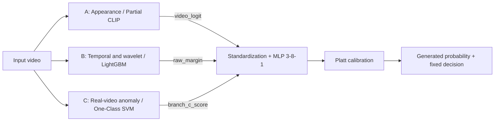

# VIDA — Three-Branch AI-Generated Video Detection

VIDA is a research system for distinguishing real videos from AI-generated videos. It
combines visual appearance, temporal and wavelet features, and deviation from real-video
motion statistics. A calibrated fusion model turns the three branch scores into a
video-level generation probability and decision.

This repository contains the branch implementations, trained-model artifacts, the
released fusion model, experiment records and reproduction tools.

[Quick start](#quick-start) · [System overview](#system-overview) · [Results](#results)
· [Models and data](#models-and-data) · [Reproduction](#reproduction)

## System overview



| Component            | Released method                                                                                  | Evidence supplied to fusion                         |
| -------------------- | ------------------------------------------------------------------------------------------------ | --------------------------------------------------- |
| Branch A: appearance | Partial CLIP ViT-B/16, Round 4                                                                   | Mean of eight frame logits, computed before sigmoid |
| Branch B: temporal   | 600-tree LightGBM over 113 temporal FFT, optical-flow/residual and temporal-wavelet features     | Raw LightGBM margin                                 |
| Branch C: anomaly    | RBF One-Class SVM, `nu=0.01`, over 37 motion and temporal descriptors fitted against real videos | Real-reference anomaly score                        |
| Fusion               | Standardized three-input MLP with 8 ReLU hidden units, followed by Platt calibration             | Generation probability and thresholded label        |

The released fusion model has 41 trainable MLP parameters. A/B/C checkpoints stay fixed
while fusion is fitted on separate videos. Larger values of each raw branch score
indicate stronger evidence of generation.

Branch A also includes frozen-head baselines and DINOv2/DINOv3 experiments. Those
experiments and the branch-specific training protocols are documented within their
modules. The table above identifies the models used by the final fusion release.

## Quick start

The released fusion model runs on CPU from an aligned A/B/C score table. Its portable
inference implementation uses NumPy and scikit-learn. The following example replays the
included final-test scores without downloading raw videos or reconstructing the branch
models.

### 1. Install the fusion environment

Use Python 3.12. These commands target a macOS/Linux shell:

```bash
GIT_LFS_SKIP_SMUDGE=1 git clone https://github.com/Jerry00C/Vida.git
cd Vida
python3.12 -m venv .venv-stacking
source .venv-stacking/bin/activate
python -m pip install -r stacking/requirements.lock.txt
```

Skipping LFS downloads keeps the large Branch A training checkpoints out of this
score-only setup. The released fusion bundle and recorded score CSV are regular
repository files. On Windows, activate `.venv-stacking\Scripts\Activate.ps1` in
PowerShell and use that environment's Python for the remaining commands.

### 2. Run the released model

Run from the repository root:

```bash
python -m stacking.predict --model-dir stacking/released_model \
  --input stacking/results/final_16400/evaluation/predictions.csv \
  --output outputs/vida_predictions.csv
```

This processes the 10,000 recorded final-test videos using their cached branch scores.
The input's labels and evaluation metadata are not model features. Use a new output
filename for subsequent runs; the CLI preserves existing prediction files.

The output contains:

| Column                  | Meaning                                                |
| ----------------------- | ------------------------------------------------------ |
| `clip_id`               | Input video identifier                                 |
| `generated_probability` | Calibrated probability assigned to the generated class |
| `prediction_generated`  | `1` for generated, `0` for real                        |
| `threshold`             | Frozen decision threshold used for that row            |

The release uses threshold **`0.4495125162248878`**. A probability greater than or equal
to that value is classified as generated. The model hash, branch lineage and threshold
are recorded in [MODEL_LOCK.json](stacking/released_model/MODEL_LOCK.json).

### 3. Score new videos

For new videos, first run the three fixed branch models with their original
preprocessing and environments. Join their outputs by `clip_id`, then pass a CSV with
these columns to `stacking.predict`:

| CSV column | Required value                        |
| ---------- | ------------------------------------- |
| `clip_id`  | One unique identifier per video       |
| `A`        | Partial CLIP Round 4 mean video logit |
| `B`        | LightGBM raw margin                   |
| `C`        | Real-reference SVM anomaly score      |

Supply the three raw scalar scores in the same model versions and directions as the
release. All scores must be finite and refer to the same video; resolve decoding
failures or branch abstentions before fusion.

The adapters [export_a.py](stacking/export_a.py), [export_b.py](stacking/export_b.py)
and [export_c.py](stacking/export_c.py) connect the fixed branches to manifest-based
video batches. Model identities and preprocessing requirements are documented in the
[frozen protocol](stacking/FROZEN_PROTOCOL.md). Branch A's eight sparse frames and B/C's
temporal observations serve different inputs and sampling policies.

## Data and evaluation protocol

The branch-development collection contains **32,000 videos**: 16,000 real and 16,000
generated. The eight developed generator families are CogVideo, Mora, MuseV, OpenSora,
Pika, SVD, T2V-Zero and VideoCrafter2. Real sources are Vript and HD-VG-130M.

The final fusion protocol, `vida-eight-family-ms-v2-20261030`, uses a separate suite of
**16,400 original videos**:

| Role                    | Videos |  Real | Generated |
| ----------------------- | -----: | ----: | --------: |
| Fusion fitting          |  5,120 | 2,560 |     2,560 |
| Probability calibration |    640 |   320 |       320 |
| Threshold selection     |    640 |   320 |       320 |
| In-domain final test    |  8,000 | 4,000 |     4,000 |
| ModelScope final test   |  2,000 | 1,000 |     1,000 |
| Total                   | 16,400 | 8,200 |     8,200 |

Known source/prompt groups separate these roles. Final-suite video identities exclude
the original development collection and previously evaluated test videos. Complete
parent/prompt mappings are unavailable for some sources, so the audit cannot establish
absence of every semantic duplicate.

Eight generator-holdout folds within fusion fitting compare logistic-regression and MLP
candidates using validation log loss. The selected MLP is fitted for 102 epochs.
Separate sets fit probability calibration and select the fixed decision threshold;
final-test labels do not select either.

Branch B was fitted on the full 32K collection; Branch C fits real videos only. The
common development resource does not imply identical fitting sets for every branch. The
final release uses new aligned scores from its fixed A/B/C models. The
[protocol and lineage record](stacking/FROZEN_PROTOCOL.md) documents the actual fitting
scopes and historical Branch A audit limits.

## Results

The following are recorded results of the frozen release at its unchanged decision
threshold. FPR is the fraction of real videos classified as generated.

| Evaluation view                  |       Videos |     AUROC | Macro F1 | Real FPR |
| -------------------------------- | -----------: | --------: | -------: | -------: |
| In-domain originals              |        8,000 | 0.9999985 | 0.999250 | 0.000500 |
| ModelScope originals             |        2,000 | 1.0000000 | 0.999500 | 0.001000 |
| ModelScope paired format control | 2,000 copies | 0.9700260 | 0.390677 | 0.946000 |

Sources: [native test metrics](stacking/results/final_16400/evaluation/metrics.json) and
[paired-control metrics](stacking/results/format_control_ModelScope/metrics.json).

The format control reprocesses the same 2,000 ModelScope-test originals into 2-second, 8
fps, 256 × 256, H.264 CRF18 clips for both classes. It adds no independent videos. All
branch models, fusion weights, calibration and the threshold remain fixed. The real
false-positive rate rises to **94.6%** despite a high AUROC, demonstrating sensitivity
of the deployed operating point to format changes. This joint transformation does not
isolate a single causal factor such as frame rate.

Previously viewed Sora/Kling videos are retained as supplemental historical stress
tests:

| Historical view | Videos |    AUROC | Macro F1 | Generated recall |
| --------------- | -----: | -------: | -------: | ---------------: |
| Sora            |     88 | 0.872417 | 0.358100 |         0.022727 |
| Kling           |    528 | 0.954775 | 0.440255 |         0.106061 |

These results use the same fixed fusion threshold and are outside the new 16,400-video
suite. See the
[historical metrics](stacking/results/final_16400/report/historical_pressure_metrics.json).

ModelScope is the designated generated-family holdout under the project's declared data
protocol; its real controls come from known sources. Earlier ModelScope results had
already been observed when the final evaluation was planned. The independent-sample
result is therefore a confirmation on new videos, and the native high scores do not
establish general performance across all generators, formats or real-video sources.

The [full results report and plots](stacking/results/final_16400/report/RESULTS_zh.md)
include individual-branch comparisons, group-bootstrap intervals, per-family results,
format diagnostics and historical stress tests. Machine-readable comparisons are in
[metrics_comparison.csv](stacking/results/final_16400/report/metrics_comparison.csv).

## Models and data

| Artifact                                       | Location                                                                                                          |
| ---------------------------------------------- | ----------------------------------------------------------------------------------------------------------------- |
| Released fusion bundle and integrity lock      | [stacking/released_model/](stacking/released_model/)                                                              |
| Selected Branch A checkpoint                   | [Partial CLIP Round 4](remote-results/adapt/training/partial/clip/round_4/best.pt), retrieved with Git LFS        |
| Branch A pretrained bases and pinned revisions | [dev/config.json](branches_dev/branch_a/dev/config.json); obtain pretrained weights separately                    |
| Sealed Branch B implementation and model       | [branches_dev/branch_b/](branches_dev/branch_b/)                                                                  |
| Branch C trained models and prediction scores  | [Artifact download guide](branches_dev/branch_c/docs/ARTIFACTS_ZH.md), hosted in the contributor's GitHub Release |
| Final training records, predictions and plots  | [stacking/results/final_16400/](stacking/results/final_16400/)                                                    |

To retrieve tracked Branch A checkpoints after installing Git LFS, run from the
repository root:

```bash
git lfs install
git lfs pull
```

Original videos, dataset PNGs, authoritative input manifests, pretrained encoder caches
and local environments are distributed separately. Dataset and pretrained-model access
requirements are documented with each branch. Branch B is a sealed package with
byte-level checksums; retain its contents when installing or producing outputs.

## Reproduction

Keep separate environments for the branch deliveries and fusion code:

| Workflow                  | Environment and guide                                                                                                                                                                                            |
| ------------------------- | ---------------------------------------------------------------------------------------------------------------------------------------------------------------------------------------------------------------- |
| Frame extraction          | [Preprocessing guide](preprocessing/README.md)                                                                                                                                                                   |
| Branch A                  | Python 3.11 with PyTorch/Transformers; [baseline](branches_dev/branch_a/dev/README.md), [partial fine-tuning](branches_dev/branch_a/dev/ADAPTATION.md) and [remote setup](branches_dev/branch_a/REMOTE_SETUP.md) |
| Branch B                  | Pinned portable runtime; reference Python 3.14.6 on Windows AMD64; [runtime guide](branches_dev/branch_b/docs/README.md) and [model card](branches_dev/branch_b/docs/MODEL_CARD.md)                              |
| Branch C                  | Python 3.12 and its locked CPU dependencies; [setup and experiments](branches_dev/branch_c/README.md)                                                                                                            |
| Released fusion inference | Python 3.12 and [requirements.lock.txt](stacking/requirements.lock.txt)                                                                                                                                          |
| Fusion MLP training       | Separate PyTorch environment from [requirements.neural.lock.txt](stacking/requirements.neural.lock.txt); [training guide](stacking/TRAINING.md)                                                                  |

To reproduce the final fusion experiment, obtain the exact data manifests, fixed branch
checkpoints and matched score exports, configure a new run using
[config.expanded.example.json](stacking/config.expanded.example.json), and follow
[TRAINING.md](stacking/TRAINING.md). The expanded pipeline verifies dataset roles, score
completeness and checkpoint lineage before fitting.

The module guides also retain earlier branch experiments and the
[legacy OOF interface](stacking/LEGACY_OOF.md). The released final results correspond to
the expanded protocol and the model locked in `stacking/released_model/`.

### Fusion checks

Run these checks from the repository root in the fusion environment:

```bash
python -m pytest stacking/tests/test_pipeline.py \
  stacking/tests/test_expanded.py stacking/tests/test_neural.py \
  stacking/tests/test_export_resume.py stacking/tests/test_predict_portable.py -q
```

Branch-specific suites and smoke workflows are documented in their respective guides.
Synthetic smoke outputs are labelled separately from measured real-video evaluation
results.

## Repository map

```text
Vida/
  preprocessing/               Video decoding, frame extraction and validation
  branches_dev/
    branch_a/                  Appearance baselines and partial fine-tuning
    branch_b/                  Sealed temporal-wavelet model package
    branch_c/                  Real-video anomaly model and experiments
  remote-results/              Recorded Branch A runs and LFS checkpoints
  stacking/
    released_model/            Portable final fusion model
    results/                   Training, evaluation and protocol evidence
    tests/                     Fusion and integration checks
    export_a.py                Fixed appearance-score export
    export_b.py                Fixed temporal-score export
    export_c.py                Fixed anomaly-score export
    predict.py                 Fusion inference from aligned scalar scores
    expanded.py                Final fusion selection, fitting and evaluation
```
