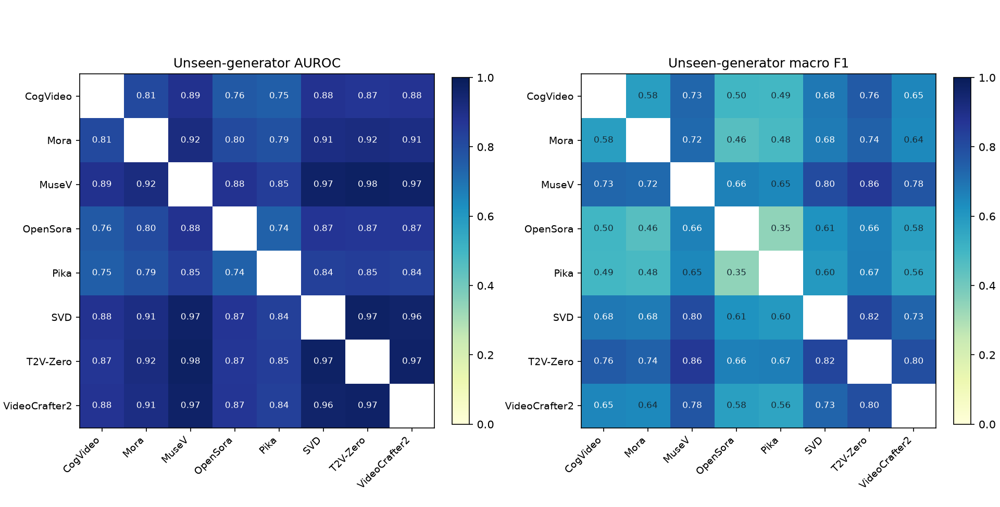
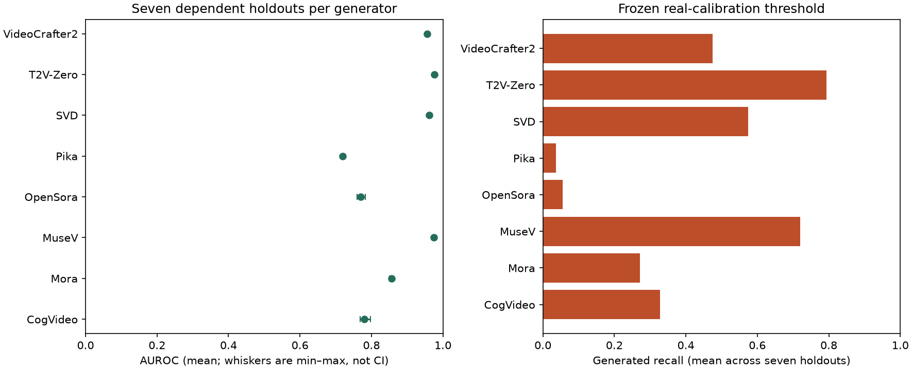

# Branch C aggregate results

These are historical results completed on 2026-10-15 using the private VIDA-Guard32K delivery. No dataset is included here.

| Metric | Mean across 28 unseen-generator holdouts |
| --- | ---: |
| AUROC | 0.8742379464 |
| Macro F1 | 0.6516194659 |
| Generated recall at the fixed threshold | 0.4066964286 |
| Real false positive rate | 0.030625 |

- `summary.json`: aggregate metrics, selected candidate counts and generator summaries.
- `metrics_by_round.csv`: one aggregate row per round and evaluation view; no clip-level predictions.
- `generator_summary.csv`: per-generator summaries across its seven held-out appearances.
- `protocol_summary.json`: split and selection rules without per-video manifests.
- `verification_summary.json`: historical numerical verification and test counts.
- The two PNG files below are plots of aggregate measurements, with no video frames.

The 28 rounds overlap. Their mean and range are descriptive, not 28 independent experiments. This is a repartitioning of an already evaluated cohort, not a fresh blind test. The protocol has no two permanently sealed final-test generators. A/B comparisons and fusion gains have not been established. Source/conditioning/content confounds and unknown semantic duplicates remain.

## Team integration

The current Branch A README in this repository describes four provisional holdout rounds with approximately 70/15/15 partitions. These Branch C results use all 28 generator pairs and 60/10/10/20 train/model-selection/calibration/test partitions. Their existing scores cannot be joined as one experiment. Agree on a common manifest, group boundaries, validation roles and OOF folds first, then produce A/B/C scores for that same protocol.

The later diagram with six development generators, three inner rounds, and two permanently locked final-test generators is a separate proposal. This upload does not claim to have executed it.
