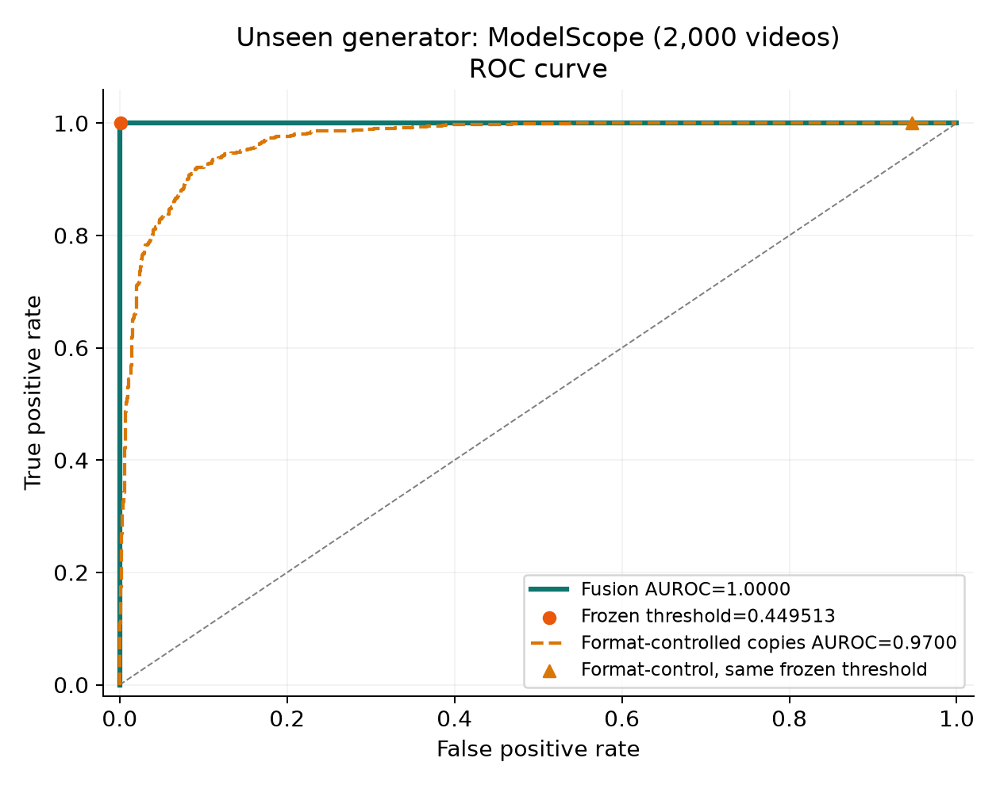
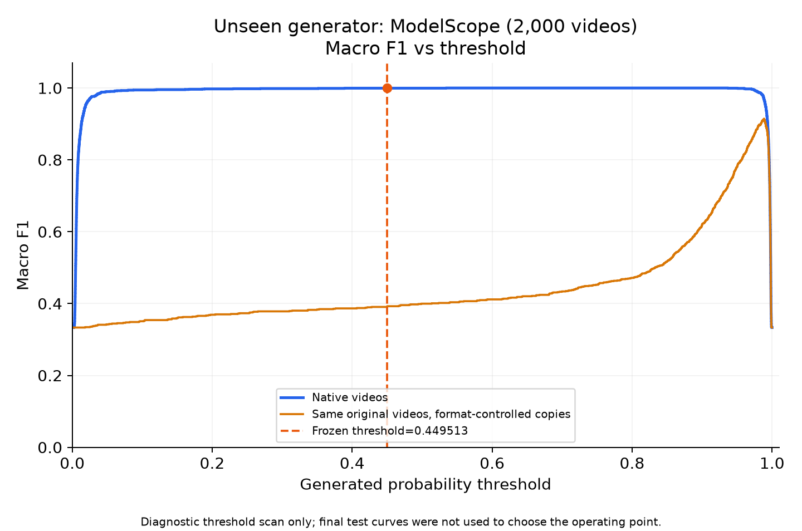

# VIDA V2：16,400 条正式融合实验结果

本次使用真实三路分数，最终融合器为 **MLP 3-8-1**。原 32K 和已完成 V1 均保留。主套件为互不重复的 16,400 条原始视频；格式控制副本与历史压力测试另列，不虚增独立样本数。

## 数据与训练边界

| 阶段 | 条数 | Real | Generated |
|---|---:|---:|---:|
| 融合训练 | 5,120 | 2,560 | 八家各 320，共 2,560 |
| 概率校准 | 640 | 320 | 八家各 40，共 320 |
| 阈值选择 | 640 | 320 | 八家各 40，共 320 |
| 域内最终测试 | 8,000 | 4,000 | 八家各 500，共 4,000 |
| ModelScope 最终测试 | 2,000 | 1,000 | ModelScope 1,000 |

Real 各阶段按 Vript:HD-VG=3:1。旧 V1 的 3,200 条开发视频保留原角色复用；原 32K 与 V1 已查看测试视频及已知源组排除。按 source/prompt 连通分量隔离全部五个阶段；未知完整 prompt/parent 映射的数据不声称已证明所有语义重复不存在。Vript 新集每个 parent 最多 8 个场景，置信区间按 group 重采样，不能将相关场景当完全独立样本。

拟合前联合媒体兼容修正：B 的冻结接口要求至少 1 秒，一条 HD-VG 概率校准视频仅 24 帧/30FPS=0.8 秒而被拒绝。按确定性哈希顺序、仅媒体 QC 从未用候选中补一条同来源 real；训练/阈值选择/最终测试视频及所有配额不变。前后清单哈希与缓存迁移记录保留在结果包 protocol/JOINT_MEDIA_CORRECTION.json，本机完整原件位于新套件 internal；没有看候选预测分数、绕过 B 质检、补造分数或按测试正确率选样。

三路不重训：A=Partial CLIP Round4，B=原全 32K LightGBM，C=既有 real-only svm_nu_0.01。原 32K 是共同开发池，不等于 A/C 每个 checkpoint 实际均拟合 32K。A 旧分数跨环境复现仍有已记录差异；新套件统一使用本机固定版本，未混用旧模型版本。

原 32K 交付清单保留最初的固定 split，属于历史设计。当前 B 已拟合整个 32K，所以其中标成 cross_test 的四家也不能再当该 B 的未见生成器。本次将原八家全部视为项目已开发来源，另用新样本评估；只有 ModelScope 是本主实验的生成器留出。

本项目按自定义协议重组官方来源，不等同于官方榜单的固定 Train/Test。[GenVidBench Table 2](https://arxiv.org/html/2501.11340v2) 原本将 ModelScope 列在官方 Train；我们的原 32K 未选择它，因此应依据本项目实际样本与模型交付记录判断是否留出，而不能直接套用官方 Train 标签。

## 融合训练与超参数

融合输入仅 A video_logit、B raw_margin、C anomaly score。选模只用 fusion_train 内的八轮留生成器验证：每轮剔除一家，并清除与验证源组/prompt 相连的训练样本；真实验证组按来源分层。它是融合阶段的生成器留出，不代表原 ABC 对原八家均从未训练过。每轮数量记录在 family_cv_folds.json，全部训练样本各验证一次。

LR C=[0.001,0.01,0.1,1,10,100]，lbfgs max_iter=2000、tol=1e-8。MLP=3→8→1，共 41 参数；ReLU、dropout=0.1、AdamW lr=0.001、weight_decay=0.001、batch=64、max_epochs=200、patience=20、min_delta=0.0001、seed=42。每轮恢复最低验证损失权重；最终 MLP epoch 取八轮最佳值中位数。

最佳 LR 平均留生成器 log loss=0.001338（C=10.0）；MLP=0.000942。最终选型 **MLP 3-8-1**；MLP 训练候选的最终 epoch=102。这些为选模验证成绩，不是测试成绩。

最终融合器实际 epoch=102，LR 求解器迭代=None；按所选模型使用其中一项，另一项不适用。LR 的数值求解迭代不称为深度学习 epoch。

概率校准使用独立 640 条：标准化一维 margin + Platt logistic C=1。另一独立 640 条选择 macro-F1 最大的阈值，平分时优先接近 0.5 的阈值；最终固定为 **0.44951252**。V2 在查看新主测试结果前确定该规则，避免平分时总选极端高阈值；未按新测试曲线重新选阈值。

## 主测试结果

| 视图 | n | AUROC（95% group bootstrap CI） | Macro F1 | Generated recall | Real FPR |
|---|---:|---:|---:|---:|---:|
| in_domain | 8000 | 1.0000 (1.0000–1.0000) | 0.9992 | 0.9990 | 0.0005 |
| ModelScope | 2000 | 1.0000 (1.0000–1.0000) | 0.9995 | 1.0000 | 0.0010 |
| ID_Pika | 1000 | 1.0000 (1.0000–1.0000) | 1.0000 | 1.0000 | 0.0000 |
| ID_VideoCrafter2 | 1000 | 1.0000 (1.0000–1.0000) | 1.0000 | 1.0000 | 0.0000 |
| ID_T2V-Zero | 1000 | 1.0000 (1.0000–1.0000) | 1.0000 | 1.0000 | 0.0000 |
| ID_OpenSora | 1000 | 1.0000 (1.0000–1.0000) | 1.0000 | 1.0000 | 0.0000 |
| ID_SVD | 1000 | 1.0000 (1.0000–1.0000) | 1.0000 | 1.0000 | 0.0000 |
| ID_MuseV | 1000 | 1.0000 (1.0000–1.0000) | 0.9960 | 0.9920 | 0.0000 |
| ID_Mora | 1000 | 1.0000 (1.0000–1.0000) | 1.0000 | 1.0000 | 0.0000 |
| ID_CogVideo | 1000 | 1.0000 (1.0000–1.0000) | 1.0000 | 1.0000 | 0.0000 |

域内八家等权平均 AUROC=1.0000。八家逐来源视图各用相同的 500 real 控制样本（375 Vript、125 HD），这些负样本复用，不能把视图条数相加当独立样本。

## ModelScope 的格式混杂与配对控制

主测试在项目数据划分上属于跨生成器留出：ModelScope 不参与项目原 32K 池、融合训练、校准或阈值选择；B/C 的训练范围有交付记录支持，A 未发布完整逐条训练 ID 审计清单，不能从权重本身证明全部历史。Vript/HD 是已知真实来源，不能把该主测试称为真假两侧来源均未知的跨来源测试。

V1 的 ModelScope 表现已经查看过，V2 是在独立新样本上复验；它不是对该生成器首次、完全未观察过历史结果的盲测。把 ModelScope 定位为主跨生成器测试，是比较过 V1 三家结果之后作出的来源选择，存在选择偏差；应连同 Sora/Kling 历史压力结果报告，不能凭单一来源概括整体跨生成器能力。扩大规模、校准规则和主/补充测试定位均在 V2 新测试推理结果前记录，不能据新结果事后更换测试来源或阈值。

V1 核查发现：ModelScope 原片为 256×256、8FPS、2 秒，而真实对照通常更高清、更高帧率；仅按 FPS 就可分开 V1 那组标签。因此主测试的优秀原片成绩不能单独证明排除了格式捷径。V2 同时另做完整 2,000 条配对控制：真假均取首 2 秒、8FPS、256×256、H264 CRF18；三路、融合器和阈值全部冻结。它们是同一批原始视频的副本，不是新收集的 2,000 条独立视频。

| ModelScope 配对测试 | AUROC | Macro F1 | Generated recall | Real FPR |
|---|---:|---:|---:|---:|
| 原片 | 1.0000 | 0.9995 | 1.0000 | 0.0010 |
| 同格式副本 | 0.9700 | 0.3907 | 1.0000 | 0.9460 |

ROC 随阈值移动工作点，AUROC 是整条 ROC 的面积；Macro F1 曲线显示不同阈值的分类表现。图中扫描只作诊断，正式指标始终使用独立阈值选择集确定的固定阈值。

V1 已观察到的 FPS≤12 判生成规则，在 V2 融合拟合前固定，仅于模型冻结后作元数据诊断：该原片 2,000 条上 negative-FPS AUROC=1.0000、固定规则 Macro F1=1.0000。它不是学习生成痕迹的检测器；若仅元数据就能区分标签，更不能将原片高分直接归因于普适生成痕迹。计划和结果均随包保留。

统一处理同时改变 FPS、分辨率、编码与时间窗口；正方形缩放也会改变原本宽屏视频的宽高比，不能隔离单项因果作用。该压力对照只分析冻结模型的敏感性，未用于模型或阈值选择。V1 256 条历史配对诊断及数据泄漏核查在结果包 audit/modelscope_v1，含逐视频分数、媒体映射核验和冻结 V1 小融合器；本机完整原始视频证据仍保留在旧目录 internal/modelscope_correctness_audit_20261030。

## 单路对照

| 视图 | A raw AUROC | B raw AUROC | C raw AUROC | Fusion AUROC |
|---|---:|---:|---:|---:|
| in_domain | 0.9955 | 1.0000 | 0.8641 | 1.0000 |
| ModelScope | 0.9996 | 1.0000 | 0.8317 | 1.0000 |

## 历史补充压力测试

以下复用 V1 已经查看过的视频，只做历史对照，不属于 V2 新盲测或主套件；未参与 V2 拟合/选阈值。Sora/Kling 与等量 Vript real 配对，另保留原 V1 的 ModelScope+UCF101 视图作为真实来源变化的历史参照。

| 视图 | n | AUROC | Macro F1 | Generated recall |
|---|---:|---:|---:|---:|
| Sora | 88 | 0.8724 | 0.3581 | 0.0227 |
| Kling | 528 | 0.9548 | 0.4403 | 0.1061 |
| ModelScope_UCF101_historical | 1200 | 1.0000 | 0.9983 | 1.0000 |

## 文件作用

| 文件 | 用途 |
|---|---|
| stacker.joblib / MODEL_LOCK.json | 已训练模型、标准化、校准、固定阈值及版本校验；在报告目录上一级 |
| training_report.json / family_cv_folds.json | 训练超参数、八轮实际样本角色和损失；在报告目录上一级 |
| metrics_comparison.csv | 主测试、单路对照及补充测试指标，供 Excel/分析工具读取 |
| ../evaluation/predictions.csv | 原片主测试逐视频三路分数与融合概率 |
| ModelScope_ROC.png / ModelScope_MacroF1_threshold.png | ModelScope 专属曲线，阈值扫描仅展示、不重新选择 |
| in_domain_ROC.png / in_domain_MacroF1_threshold.png | 域内测试曲线 |
| MLP_family_holdout_epoch_curves.png | 八轮 MLP 实际 epoch 曲线及全训练集拟合曲线 |
| historical_pressure_metrics.json | 已知的历史压力测试结果及明确角色 |
| fusion_latency.json | 仅缓存三路分数后的融合层 CPU 耗时，不是端到端视频延迟 |

完美分类样本的经验 bootstrap 可能给出 [1,1]，不能据此保证总体零错误。ModelScope 是单一且相对较早的生成器，不能将其结果泛化为所有现代生成器均有效。
